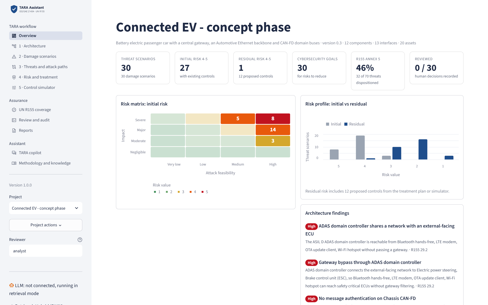
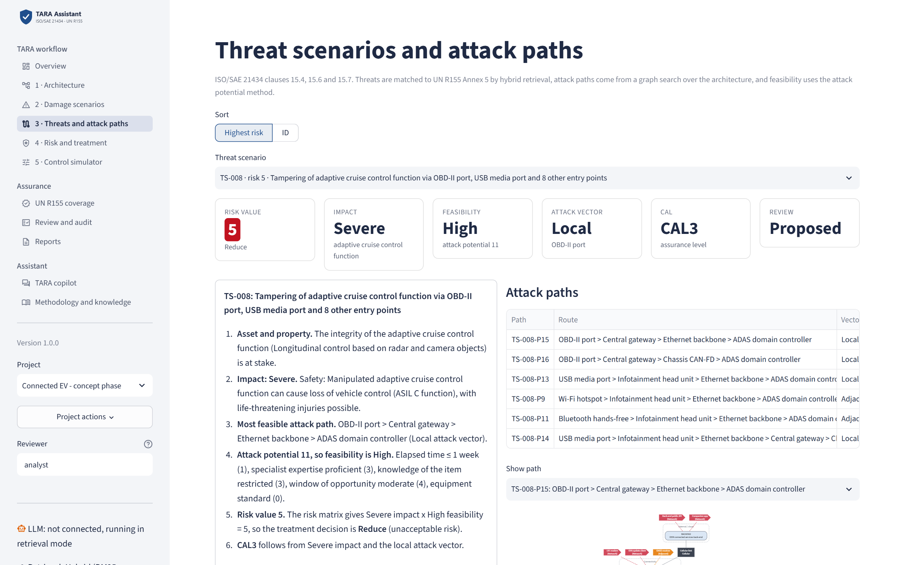
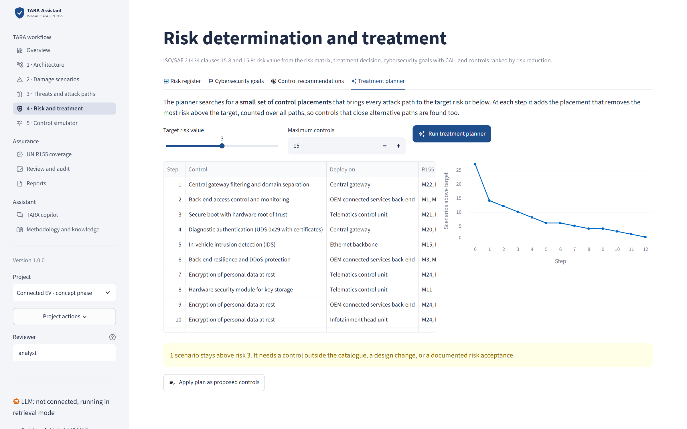
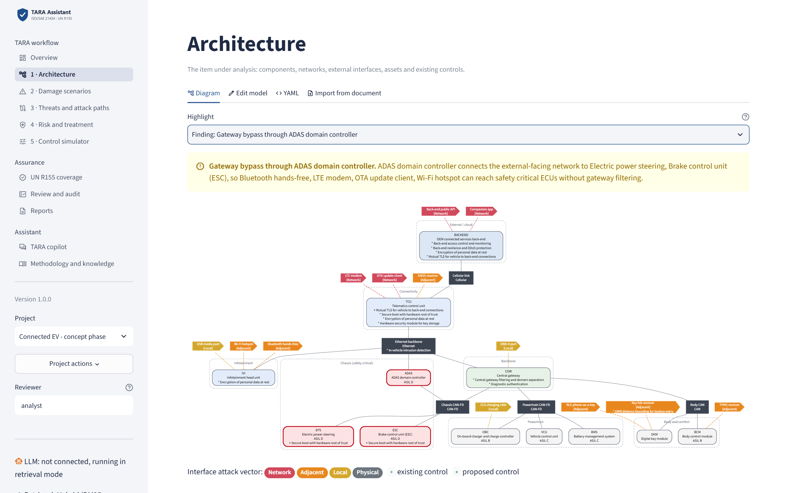
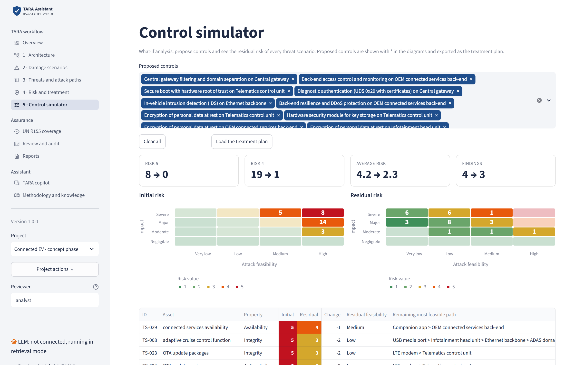
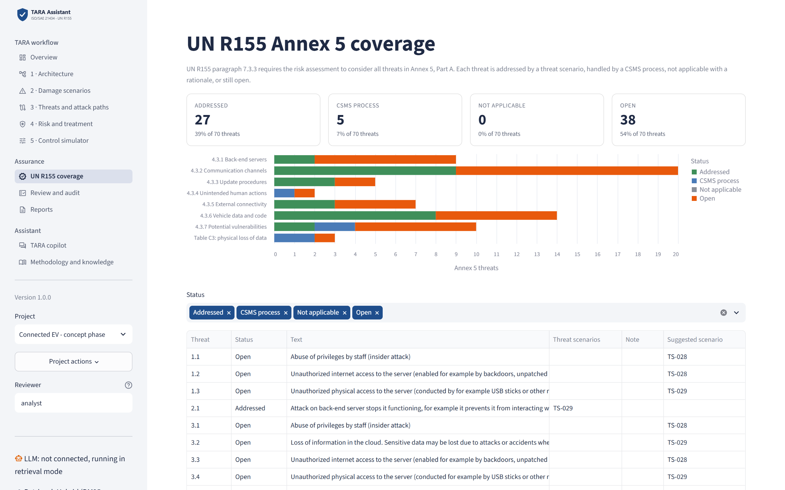
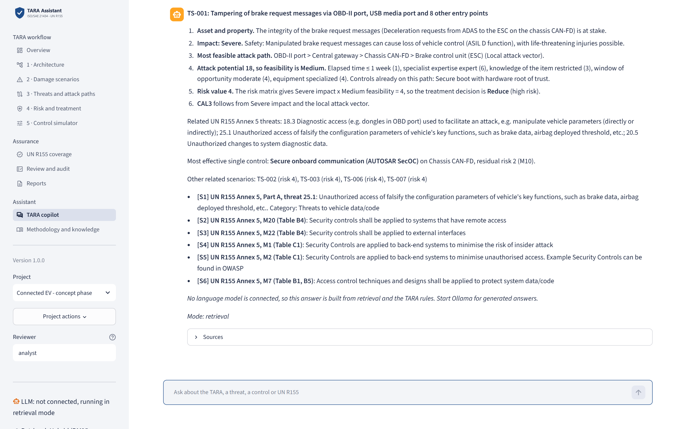
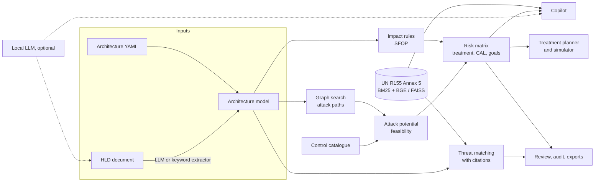

# Automotive TARA Assistant

**AI-assisted Threat Analysis and Risk Assessment (TARA) for vehicle E/E architectures, aligned with ISO/SAE 21434 and grounded in UN Regulation No. 155.**

Model a vehicle architecture, or let the assistant draft it from a design document. The tool then:

- finds every attack path from every external interface
- rates impact and attack feasibility with transparent, configurable rules
- links each threat scenario to the official UN R155 Annex 5 threats and mitigations, with citations
- proposes cybersecurity goals, CAL and a minimal set of controls that brings every risk to an acceptable level

Engineers review and approve every proposal, and every decision is logged.



> Built as the capstone project for the Tata Technologies TechPulse Applied AI & ML program (Case Study 3: Automotive Cybersecurity TARA Assistant).

---

## Why this project

UN R155 makes a cybersecurity management system and a risk assessment mandatory for vehicle type approval. The regulation requires every threat in its Annex 5 to be considered (paragraph 7.3.3). In practice, TARAs are done by hand in spreadsheets: slow, inconsistent between engineers, and hard to trace.

Most "AI for TARA" demos ask a language model to write the whole analysis. The results can't be reproduced, audited or defended in an assessment. This project takes the opposite approach:

| Layer | What does the work | Why |
|---|---|---|
| Attack paths | Graph search over the architecture (NetworkX) | Complete and reproducible, never guessed |
| Impact and feasibility | Rules from a methodology profile (YAML) | Every rating traces to an approved rule |
| Risk, CAL, treatment | ISO/SAE 21434 risk matrix and decision rules | Deterministic and explainable |
| Threat knowledge | Hybrid retrieval over the **official** R155 Annex 5 text | Every threat and mitigation is cited |
| Language model (optional) | Architecture extraction, grounded Q&A | Useful where language helps, never the source of a rating |

The whole tool works **without an LLM**. With a local model through Ollama, the copilot and document import get better, and engineering data stays on the machine, as the case study requires.

## Features

**TARA workflow (ISO/SAE 21434 clause 15)**
- **Architecture model**: components with ASIL, networks (CAN, CAN-FD, Ethernet, LIN, cellular), 15 external interface types, assets with cybersecurity properties, and existing controls. Edit it in tables, as YAML, or import it.
- **Damage scenarios**: Safety, Financial, Operational and Privacy impact, proposed by rules. Every rating can be overridden, and the override is logged with the engine's original proposal.
- **Attack path analysis**: every path from every entry point, scored with the attack potential method (elapsed time, expertise, knowledge, window of opportunity, equipment). Each additional ECU on the path, and each control on it, changes the score.
- **Risk and treatment**: risk matrix, treatment decision, cybersecurity goals and CAL.

**What makes it different**
- **Official UN R155 Annex 5 library**: 70 threats and 23 mitigations, parsed from the EUR-Lex text with a reproducible script. The parser handles merged table cells and keeps the regulation's own numbering (for example, there is no M17 and no item 14).
- **Architecture findings**: automatic detection of design flaws. Examples are an ASIL D controller that bridges the external-facing Ethernet backbone to the chassis CAN without passing the gateway (R155 threat 29.2), or safety-critical buses without SecOC.
- **Automatic treatment planner**: a greedy search for the **smallest set of control placements** that brings every attack path to the target risk. In the sample vehicle, 12 controls take 27 high risks down to 1.
- **Control simulator**: what-if analysis with initial and residual risk side by side.
- **R155 coverage tracking**: each Annex 5 threat is addressed by a scenario, handled by a CSMS process, marked not applicable with a rationale, or left open. Open items come with a suggested scenario.
- **Design document import**: upload an HLD (PDF, Markdown, text) and the assistant drafts the architecture model for review. This links to Case Study 1.
- **Grounded copilot**: answers cite R155 entries, controls, uploaded documents and TARA rows. Without an LLM, it explains every risk value step by step.
- **Traceability**: review workflow (Proposed, Accepted, Modified, Rejected), a full audit log, baselines and change impact analysis.
- **Exports**: an Excel TARA workbook (10 sheets), a printable HTML report, JSON, and a FastAPI service for integration.

## Screenshots

| Attack path analysis with R155 references | Automatic treatment planner |
|---|---|
|  |  |
| **Architecture with a highlighted finding** | **Control simulator** |
|  |  |
| **UN R155 Annex 5 coverage** | **Grounded copilot** |
|  |  |

## Quick start

Requires Python 3.11.

```bash
git clone https://github.com/jineshagandhi/automotive-tara-assistant.git
cd automotive-tara-assistant
pip install -r requirements.txt
streamlit run app/main.py
```

Open http://localhost:8501. A sample project (a connected EV at concept phase) loads automatically. On first start, the BGE embedding model (about 65 MB) is downloaded once to `~/.cache/automotive-tara` (about 10 seconds). Set `TARA_EMBEDDINGS=off` to run fully offline with BM25 only.

**5-minute demo**
1. **Overview**: risk matrix, findings and R155 coverage for the sample vehicle.
2. **Architecture**: under *Highlight*, pick "Finding: Gateway bypass through ADAS domain controller".
3. **Threats and attack paths**: the step-by-step derivation of a risk value, with R155 citations.
4. **Risk and treatment > Treatment planner**: run it, then click *Apply plan as proposed controls*.
5. **Control simulator**: initial and residual risk side by side.
6. **Reports**: download the Excel TARA workbook.

**Optional local LLM** (a 7B model runs on a 6 GB GPU):

```bash
ollama pull qwen2.5:7b      # detected automatically when Ollama is running
```

**REST API** (optional, for integration with other tools)

```bash
uvicorn api.main:app --reload     # docs at http://127.0.0.1:8000/docs
```

## Architecture



| Path | Content |
|---|---|
| `tara/engine.py` | TARA engine: damage scenarios, attack paths, feasibility, risk, treatment, findings, coverage, planner |
| `tara/graph.py` | Architecture graph and attack path search |
| `tara/methodology/` | Rating logic and the ISO/SAE 21434 example profile (YAML) |
| `tara/knowledge/` | R155 Annex 5 library, interface and control catalogues, impact rules |
| `tara/retrieval.py` | Hybrid retrieval: BM25 and BGE embeddings in FAISS, reciprocal rank fusion |
| `tara/copilot.py`, `tara/extraction.py`, `tara/llm.py` | Grounded Q&A, document extraction, pluggable LLM |
| `tara/store.py`, `tara/export.py`, `tara/compare.py` | SQLite persistence and audit, Excel/HTML/JSON export, change impact |
| `app/` | Streamlit UI |
| `api/` | FastAPI service |
| `scripts/build_r155_library.py` | Rebuilds the R155 library from the official EUR-Lex text |
| `eval/` | Retrieval evaluation set and script |
| `tests/` | 88 tests, including UI tests |

More detail: [docs/design.md](docs/design.md).

## Evaluation

**R155 retrieval.** 30 paraphrased engineering queries (for example "a cheap dongle in the OBD socket rewrites calibration values"), each labelled with the correct Annex 5 threat:

| Retriever | Hit@1 | Hit@3 | MRR |
|---|---|---|---|
| BM25 with automotive synonyms | 70% | 83% | 0.77 |
| Hybrid: BM25 + BGE-small (FAISS), reciprocal rank fusion | **80%** | **83%** | **0.83** |

The synonym list was not tuned on this set. The misses are listed in [eval/results.md](eval/results.md). Run it with `python eval/retrieval_eval.py`.

**Tests.** `pip install -r requirements-dev.txt`, then `pytest` runs 88 tests covering:
- the regulation library against the official numbering
- the methodology tables
- attack path search
- engine behaviour, e.g. SecOC lowers brake manipulation risk but not availability risk
- the planner, with a check that its result matches a full re-run
- exports, the store, the API, LLM grounding with a fake model, and every UI page

## Methodology and sources

- **UN Regulation No 155**, Annex 5 Parts A, B and C. Text from the Official Journal of the European Union, L 82, 9.3.2021 (CELEX 42021X0387), parsed by `scripts/build_r155_library.py`.
- **ISO/SAE 21434:2021** clause 15 structure. The attack potential values, feasibility bands, risk matrix and CAL table in `tara/methodology/iso21434_default.yaml` are the example values commonly used with the informative annexes. The standard itself is not reproduced. Replace the profile with your organisation's approved rules via `TARA_PROFILE`.
- **Controls** reference AUTOSAR SecOC and IdsM, Uptane / UN R156, ISO 14229-1 (UDS 0x29), ISO 15118, IEEE 1609.2 and the CCC Digital Key.

## Limitations

- The sample vehicle and its design document are fictional.
- Default feasibility factors and control effects are starting estimates for the analyst to review, not validated values.
- Keyword-based document extraction recognises common ECUs and interfaces only. Use an LLM for other documents.
- This tool supports qualified cybersecurity engineers. It does not replace their judgement or approval.

## Roadmap

- A cross-encoder reranker for R155 retrieval
- Import from ARXML and communication matrices (DBC)
- Links to HARA safety goals (Case Study 2) and to test cases
- Multi-user access control and project isolation
